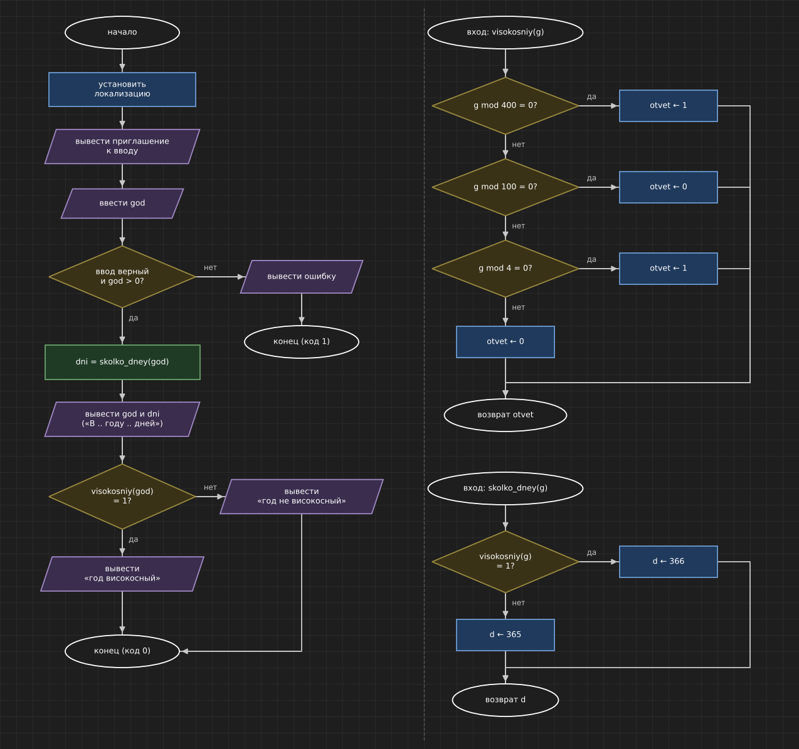

# Домашнее задание к работе 6

## Вариант 14

## Условие задачи

Написать программу, которая для введенного года определяет количество дней в нем.

## 1. Алгоритм и блок-схема

### Алгоритм

1. Начало.
2. Установить локализацию.
3. Вывести приглашение к вводу.
4. Ввести `god` — год.
5. Если ввод некорректен или `god <= 0` — вывести сообщение об ошибке и завершить программу с кодом 1.
6. Вызвать функцию `dni = skolko_dney(god)`:
   - если `visokosniy(g) = 1` → `d = 366`;
   - иначе → `d = 365`.
7. Функция `visokosniy(g)` проверяет год лестницей if-else-if:
   - если `g mod 400 = 0` → `otvet = 1` (високосный);
   - иначе если `g mod 100 = 0` → `otvet = 0` (не високосный);
   - иначе если `g mod 4 = 0` → `otvet = 1` (високосный);
   - иначе → `otvet = 0` (не високосный).
8. Вывести год и количество дней.
9. Если `visokosniy(god) = 1` — вывести «год високосный», иначе — «год не високосный».
10. Конец.

### Блок-схема



## 2. Реализация программы

```c
/*
 * Вариант 14. Количество дней в году.
 *
 * Контрольные примеры:
 *   2023 -> 365 дней (не високосный)
 *   2024 -> 366 дней (високосный, кратен 4)
 *   1900 -> 365 дней (кратен 100 но не кратен 400 - не високосный)
 *   2000 -> 366 дней (кратен 400 - високосный)
 *   1    -> 365 дней (граница, самый маленький год)
 *   0    -> ошибка
 *   -5   -> ошибка
 */
#define _CRT_SECURE_NO_WARNINGS
#include <stdio.h>
#include <locale.h>

int visokosniy(int g);
int skolko_dney(int g);

int main()
{
    int god;
    int dni;

    setlocale(LC_ALL, "Rus");

    printf("Введите год: ");
    if (scanf("%d", &god) != 1 || god <= 0)
    {
        printf("Ошибка! Год должен быть целым числом больше 0\n");
        return 1;
    }

    dni = skolko_dney(god);

    printf("В %d году %d дней", god, dni);
    if (visokosniy(god) == 1)
        printf(" (год високосный)\n");
    else
        printf(" (год не високосный)\n");

    return 0;
}

/* Проверка года: 1 - високосный, 0 - не високосный */
int visokosniy(int g)
{
    int otvet;
    if (g % 400 == 0)
        otvet = 1;
    else if (g % 100 == 0)
        otvet = 0;
    else if (g % 4 == 0)
        otvet = 1;
    else
        otvet = 0;
    return otvet;
}

int skolko_dney(int g)
{
    int d;
    if (visokosniy(g) == 1)
        d = 366;
    else
        d = 365;
    return d;
}
```

## 3. Результаты работы программы

```
Введите год: 2023
В 2023 году 365 дней (год не високосный)

Введите год: 2024
В 2024 году 366 дней (год високосный)

Введите год: 1900
В 1900 году 365 дней (год не високосный)

Введите год: 2000
В 2000 году 366 дней (год високосный)

Введите год: 1
В 1 году 365 дней (год не високосный)

Введите год: 0
Ошибка! Год должен быть целым числом больше 0

Введите год: -5
Ошибка! Год должен быть целым числом больше 0
```

## 4. Информация о разработчике

Кочергин Савелий, группа бИД-261
